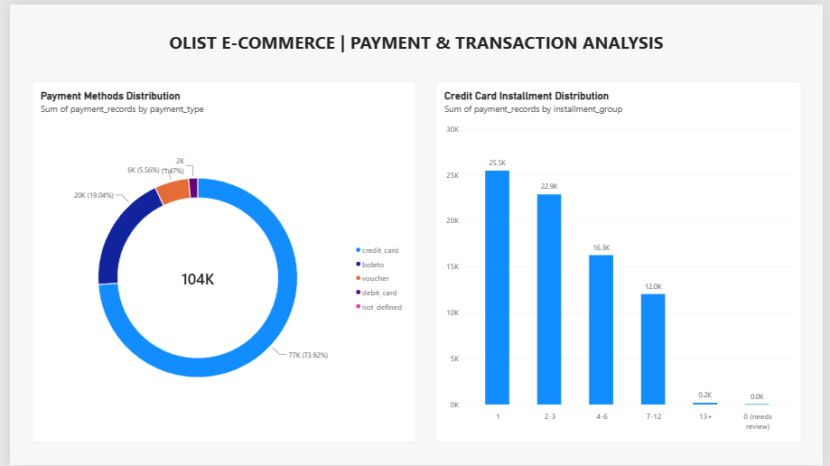

# Olist E-Commerce Business Intelligence Project

An end-to-end Business Intelligence portfolio project analyzing Brazilian e-commerce data to evaluate sales performance, product categories, delivery operations, customer satisfaction, and payment behavior using Python, MySQL, and Power BI.

---

## Project Overview

This project analyzes the business performance of Olist, a Brazilian e-commerce platform, using data analytics and Business Intelligence techniques.

The objective is to transform raw e-commerce transactional data into meaningful business insights through data cleaning, data quality validation, SQL analysis, exploratory data analysis (EDA), and interactive dashboard development.

The analysis focuses on four main business areas: sales performance, product category contributions, delivery efficiency and customer satisfaction, and payment behavior.

The results are presented through an interactive Power BI dashboard to support data-driven business decision-making.

## Project Objectives

- Analyze overall merchandise sales and order performance.
- Identify monthly sales trends and high-performing product categories.
- Evaluate delivery performance and identify late delivery patterns.
- Compare customer review scores between delivery performance groups.
- Analyze payment methods, transaction values, and credit card installment patterns.
- Develop interactive dashboards to communicate business insights.
- Translate analytical findings into meaningful business recommendations.

## Tools & Technologies

| Tool | Purpose |
|---|---|
| Python | Data cleaning, data validation, exploratory data analysis, and preprocessing |
| Pandas & NumPy | Data manipulation and numerical analysis |
| Matplotlib | Exploratory data visualization |
| Jupyter Notebook | Data cleaning and EDA workflow |
| MySQL Workbench | Database staging, data quality validation, SQL transformation, and business analysis |
| Power BI Desktop | Data modeling, DAX measures, and interactive dashboard development |
| Git & GitHub | Version control and project documentation |

## Dataset

This project uses the Brazilian E-Commerce Public Dataset by Olist.

**Dataset Source:** [Brazilian E-Commerce Public Dataset by Olist – Kaggle](https://www.kaggle.com/datasets/olistbr/brazilian-ecommerce)

The original dataset contains nine CSV files covering:

1. Customers
2. Geolocation
3. Orders
4. Order Items
5. Order Payments
6. Order Reviews
7. Products
8. Sellers
9. Product Category Translation

The original datasets are stored separately from the processed datasets to maintain data integrity and traceability.

## Data Preparation & Analysis

The project follows a structured analytical workflow consisting of Python, SQL, and Power BI.

### 1. Python – Data Cleaning and Exploratory Data Analysis

Python was used to inspect, clean, validate, and explore the Olist datasets.

The Python workflow is organized into two main notebooks:

**Notebook 01 – Data Cleaning**

The cleaning process includes:

- Inspecting dataset structures and dimensions.
- Identifying missing values.
- Checking duplicate records.
- Converting date and numeric data types.
- Investigating data inconsistencies.
- Preparing cleaned datasets.
- Generating supporting data quality reports.

**Notebook 02 – Exploratory Data Analysis**

The EDA process focuses on:

- Sales performance and product category contributions.
- Delivery performance and late delivery analysis.
- Customer review score comparisons.
- Payment method distribution and transaction characteristics.
- Credit card installment behavior.

Python was also used to prepare and validate the order reviews dataset through supporting scripts:

- `check_reviews_csv.py`
- `inspect_reviews_row.py`
- `prepare_reviews_tsv.py`

### 2. MySQL – Data Quality Validation and Business Analysis

MySQL Workbench was used to prepare and analyze the Olist database.

A total of 25 sequential SQL scripts were developed to support the database workflow.

The SQL process includes:

- Creating the database and raw staging tables.
- Investigating missing values and duplicate records.
- Validating review identifiers and geolocation records.
- Checking numeric formats and value ranges.
- Investigating date formats and chronological inconsistencies.
- Preparing cleaned database tables.
- Creating six business analysis views.
- Validating delivery and customer review analytical results.

The final analytical views cover:

1. Monthly Sales
2. Category Sales
3. Delivery Review Order Level
4. Delivery Rating Summary
5. Payment Methods
6. Credit Card Installments

The delivery and review analytical view contains 96,282 eligible delivered orders, consistent with the final Python EDA results.

### 3. Power BI – Data Modeling and Visualization

Power BI Desktop was used to transform the prepared analytical data into an interactive Business Intelligence dashboard.

The dashboard consists of three main analytical pages.

## Dashboard Overview

### 1. Sales Performance

This page provides an overview of Olist's sales performance and product category contributions.

**Key Performance Indicators:**

- Total Merchandise Sales (GMV): BRL 13.22 Million
- Total Delivered Orders: 96,478

**Visualizations:**

- Monthly Sales Trend (BRL)
- Top 10 Product Categories by Sales (BRL)

**Business Focus:**

Identify sales trends over time and determine which product categories contribute most significantly to overall merchandise sales.


### 2. Delivery & Customer Satisfaction

This page evaluates delivery performance and compares customer satisfaction across delivery groups.

**Key Performance Indicators:**

- Late Delivery Rate: 6.78%
- Eligible Delivered Orders: 96,282

**Visualizations:**

- Delivery Performance by Delivery Group
- Average Customer Review Score by Delivery Group

**Business Focus:**

Evaluate delivery efficiency by comparing on-time or early deliveries with late deliveries. The analysis also examines differences in average customer review scores between delivery groups.

**Metric Definition:**

The overall delivered-order count is 96,478, while delivery performance analysis uses 96,282 eligible delivered orders.

The eligible population excludes 196 delivered orders that did not meet the defined analytical criteria.

The late delivery rate is calculated using eligible delivered orders as its denominator.


### 3. Payment & Transaction Analysis

This page provides insights into customer payment methods and credit card installment behavior.

**Visualizations:**

- Payment Methods Distribution
- Credit Card Installment Distribution

**Business Focus:**

Understand the distribution of payment methods used by customers and identify the most common credit card installment patterns.



## Key Business Insights

Based on the Python EDA and SQL analysis, several findings can be highlighted.

### 1. Sales Performance

Total merchandise sales reached BRL 13,221,498.11, with 96,478 delivered orders.

The Average Order Value (AOV) was BRL 137.04.

### 2. Product Category Performance

Health and beauty, watches and gifts, and bed, bath and table were among the leading product categories by merchandise sales.

This indicates that several product categories contributed significantly to overall sales performance.

### 3. Delivery Performance

Out of 96,282 eligible delivered orders:

- 89,750 orders were delivered on time or early.
- 6,532 orders were delivered late.
- The late delivery rate was 6.78%.

The average delivery duration was 12.51 days.

### 4. Customer Satisfaction

On-time or early deliveries recorded an average review score of 4.29, while late deliveries recorded an average score of 2.27.

This indicates an association between delivery timeliness and customer satisfaction.

### 5. Payment Behavior

Credit cards represented the largest share of payment activity.

In the Python analysis of delivered-order payments, credit cards accounted for 74.03% of payment records and 78.46% of recorded payment value.

Payment analysis in SQL uses a broader dataset scope, so its payment record totals and percentages should be interpreted separately.

These findings demonstrate how Business Intelligence can help identify business performance patterns, evaluate operational efficiency, and highlight areas that may require further investigation.

## Data Quality & Analytical Considerations

Data quality validation was conducted throughout the preparation and analysis process.

Important considerations include:

- Missing values were investigated before determining their analytical treatment.
- Duplicate records were examined based on relevant identifiers.
- Date and numeric inconsistencies were validated.
- Delivered orders with missing or inconsistent delivery information were evaluated separately.
- Different analytical outputs may use different filtering criteria and data populations.
- Payment records and unique orders represent different measurement units.

The delivery analysis uses 96,282 eligible orders rather than all 96,478 delivered orders.

The relationship between delivery timeliness and customer review scores represents an observed association and does not independently establish causation.

## Repository Structure

```text
Mini-Project-Olist/
│
├── Dataset/
│   ├── Raw/
│   └── Processed/
│       ├── Cleaned/
│       └── olist_order_reviews_dataset.tsv
│
├── notebook/
│   ├── 01_pembersihan.ipynb
│   └── 02_eksplorasi.ipynb
│
├── Python/
│   ├── check_reviews_csv.py
│   ├── inspect_reviews_row.py
│   └── prepare_reviews_tsv.py
│
├── SQL/
│   └── 25 SQL scripts for data preparation and analysis
│
├── Documentation/
│   ├── 01_project_overview.md
│   ├── 02_data_dictionary.md
│   ├── 03_data_cleaning_process.md
│   ├── 04_sql_analysis.md
│   ├── 05_eda_findings.md
│   └── 06_power_bi_dashboard.md
│
├── Power BI/
│   ├── Olist_Ecommerce_Dashboard.pbix
│   ├── Olist_Ecommerce_Dashboard.pbip
│   ├── Olist_Ecommerce_Dashboard.Report/
│   └── Olist_Ecommerce_Dashboard.SemanticModel/
│
├── Screenshots/
│   ├── 01-sales-performance.png
│   ├── 02-delivery-customer-satisfaction.png
│   └── 03-payment-transaction-analysis.png
│
├── .gitignore
├── .gitattributes
└── README.md
```

## How to Use This Project

To explore the project and Power BI dashboard:

1. Clone or download this repository.
2. Download the Olist dataset from Kaggle if the original CSV files are not included in the repository.
3. Organize the original CSV files under `Dataset/Raw/`.
4. Configure the MySQL database and execute the relevant SQL scripts in their numbered sequence.
5. Run the Python notebooks to reproduce the data cleaning and exploratory analysis processes.
6. Open `Olist_Ecommerce_Dashboard.pbix` using Power BI Desktop, or open the PBIP project format.
7. Ensure that dataset file paths and data source connections are configured correctly.
8. Refresh the data if required.
9. Navigate through the three dashboard pages to explore the analysis.

**Note:** Data source paths may need to be adjusted depending on the local directory where the repository is stored.

## Project Scope

This project was developed as an academic and professional portfolio project to demonstrate practical knowledge of Data Analytics and Business Intelligence.

It showcases the process of transforming raw e-commerce data into structured analytical information through Python data preparation, SQL querying, data quality validation, exploratory analysis, and interactive dashboard development.

The project emphasizes both technical implementation and business interpretation to demonstrate how data analytics can support informed business decision-making.

## Author

**Angellica Ivana**

Information Systems Student

**Areas of Interest:**
- Data Analytics
- Business Intelligence
- Business Analysis
- Data Visualization

GitHub: [@angellica24](https://github.com/angellica24)

---

*This project is part of my learning journey in Business Intelligence and Data Analytics.*