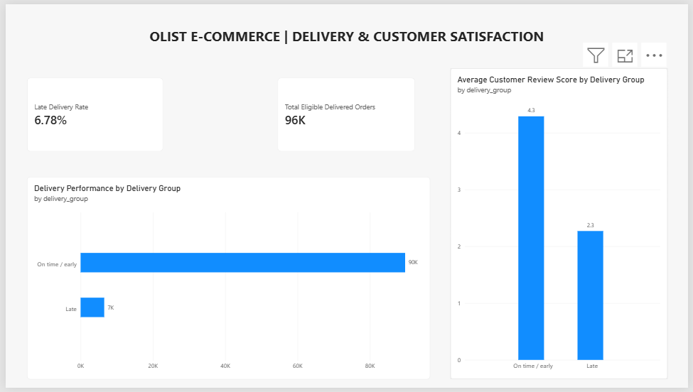

# Olist E-Commerce Business Intelligence Dashboard

An end-to-end Business Intelligence portfolio project analyzing Brazilian e-commerce data to evaluate sales performance, delivery operations, customer satisfaction, and payment behavior using MySQL, Python, and Power BI.

---

## Project Overview

This project analyzes the business performance of Olist, a Brazilian e-commerce platform, through Business Intelligence and data analytics techniques.

The objective is to transform raw e-commerce data into meaningful business insights through data preparation, data quality validation, SQL analysis, data modeling, and interactive dashboard development.

The analysis focuses on five main business areas: sales performance, product category contributions, delivery efficiency, customer satisfaction, and payment behavior. These results are presented through an interactive Power BI dashboard to support data-driven business decision-making.

## Project Objectives

- Analyze overall merchandise sales and delivered order performance.
- Identify monthly sales trends and high-performing product categories.
- Evaluate delivery performance and identify the proportion of late deliveries.
- Compare customer review scores between delivery performance groups.
- Analyze customer payment preferences and credit card installment patterns.
- Develop interactive dashboards to communicate business insights effectively.

## Tools & Technologies

| Tool | Purpose |
|---|---|
| MySQL Workbench | Data staging, data quality checks, data transformation, and business analysis |
| Python | CSV structure validation, data inspection, and review dataset preprocessing |
| Power BI Desktop | Data modeling, dashboard development, and visualization |
| Git & GitHub | Version control, project management, and documentation |

## Dataset

This project uses the Brazilian E-Commerce Public Dataset by Olist, which contains information about e-commerce transactions, customers, products, sellers, payments, reviews, and logistics.

**Dataset Source:** [Brazilian E-Commerce Public Dataset by Olist – Kaggle](https://www.kaggle.com/datasets/olistbr/brazilian-ecommerce)

The analysis covers nine datasets:

1. Customers
2. Geolocation
3. Orders
4. Order Items
5. Order Payments
6. Order Reviews
7. Products
8. Sellers
9. Product Category Translation

The original datasets are organized into the `Dataset/Raw` and `Dataset/Processed` directories.

Please refer to the original Kaggle page for dataset attribution and applicable usage terms.

## Data Preparation & Analysis

The data preparation and analysis process consists of three main components.

### 1. SQL – Data Preparation and Business Analysis

MySQL is used to prepare and analyze the Olist datasets.

The SQL workflow includes:

- Creating raw staging tables for the nine datasets.
- Performing data quality checks to identify data issues.
- Investigating missing values, duplicate records, and data inconsistencies.
- Preparing cleaned datasets for analytical purposes.
- Creating business-oriented tables and views.
- Validating analytical results before dashboard development.

Raw staging tables initially preserve source values using VARCHAR and TEXT data types to support data validation and cleaning.

### 2. Python – Data Validation and Preprocessing

Python is used to support the preparation of the order reviews dataset.

The project includes three supporting scripts:

- `check_reviews_csv.py` – Checks CSV structure consistency by identifying records with an incorrect number of columns.
- `inspect_reviews_row.py` – Inspects selected records to investigate potential data irregularities.
- `prepare_reviews_tsv.py` – Converts the original review CSV dataset into TSV format while validating column consistency.

These utilities support the review dataset preparation process, particularly in handling structural irregularities.

### 3. Power BI – Data Modeling and Visualization

Power BI Desktop is used to develop the analytical dashboard based on the prepared business datasets.

The dashboard consists of three main analytical pages, each focusing on a different aspect of business performance.

## Dashboard Overview

### 1. Sales Performance

This page provides an overview of Olist's sales performance and product category contributions.

**Key Performance Indicators:**

- Total Merchandise Sales (BRL): 13.22 Million
- Total Delivered Orders: 96,478

**Visualizations:**

- Monthly Sales Trend (BRL)
- Top 10 Product Categories by Sales (BRL)

**Business Focus:**

Identify sales trends over time and determine which product categories contribute most significantly to overall merchandise sales.


### 2. Delivery & Customer Satisfaction

This page evaluates delivery performance and compares customer satisfaction across delivery groups.

**Key Performance Indicators:**

- Late Delivery Rate: 6.78%
- Total Eligible Delivered Orders: 96,267

**Visualizations:**

- Delivery Performance by Delivery Group
- Average Customer Review Score by Delivery Group

**Business Focus:**

Evaluate delivery efficiency by comparing on-time or early deliveries with late deliveries. The analysis also examines differences in average customer review scores between delivery groups.

**Metric Definition:**

The overall delivered-order count in the sales analysis is 96,478, while the delivery analysis uses 96,267 eligible delivered orders. These metrics represent different populations based on their respective analytical definitions.

The late delivery rate is calculated using eligible delivered orders as its denominator.



### 3. Payment & Transaction Analysis

This page provides insights into customer payment methods and credit card installment behavior.

**Visualizations:**

- Payment Methods Distribution
- Credit Card Installment Distribution

**Business Focus:**

Understand the distribution of payment methods used by customers and identify the most common credit card installment patterns.


## Key Business Insights

Based on the dashboard analysis, several findings can be highlighted:

1. **Sales Performance:** Total merchandise sales reached approximately BRL 13.22 million, with 96,478 delivered orders.

2. **Product Categories:** Health and beauty, watches and gifts, and bed, bath and table were among the leading product categories by merchandise sales.

3. **Delivery Performance:** The late delivery rate was approximately 6.78%, based on 96,267 eligible delivered orders.

4. **Customer Satisfaction:** On-time or early deliveries recorded an average review score of approximately 4.3, while late deliveries recorded approximately 2.3. This indicates a notable difference in customer review scores between the two delivery groups.

5. **Payment Behavior:** Credit cards represented the largest share of recorded payment transactions, accounting for approximately 73.92% of payment records.

These findings demonstrate how Business Intelligence can help identify business performance patterns, evaluate operational efficiency, and highlight areas that may require further investigation.

## Repository Structure

```text
Mini-Project-Olist/
│
├── Dataset/
│   ├── Raw/
│   └── Processed/
│
├── Python/
│   ├── check_reviews_csv.py
│   ├── inspect_reviews_row.py
│   └── prepare_reviews_tsv.py
│
├── SQL/
│   └── SQL scripts for data preparation and analysis
│
├── Screenshots/
│   ├── 01-sales-performance.png
│   ├── 02-delivery-customer-satisfaction.png
│   └── 03-payment-transaction-analysis.png
│
├── Olist_Ecommerce_Dashboard.Report/
│
├── Olist_Ecommerce_Dashboard.SemanticModel/
│
├── Olist_Ecommerce_Dashboard.pbip
├── Olist_Ecommerce_Dashboard.pbix
├── .gitignore
├── .gitattributes
└── README.md
```

## How to Use This Project

To explore the project and Power BI dashboard:

1. Clone or download this repository.
2. Download the Olist dataset from Kaggle if the original CSV files are not included in the repository, and organize them under `Dataset/Raw/`.
3. Configure the MySQL database and execute the relevant SQL scripts in their numbered sequence.
4. Run the Python scripts from the project root directory if you want to reproduce the review dataset validation and preprocessing steps.
5. Open `Olist_Ecommerce_Dashboard.pbix` using Power BI Desktop, or open `Olist_Ecommerce_Dashboard.pbip` to access the Power BI Project format.
6. Ensure that the dataset file paths and data source connections are configured correctly.
7. Refresh the data if required.
8. Navigate through the three dashboard pages to explore the analysis.

**Note:** Data source paths may need to be adjusted depending on the local directory where the repository is stored.

## Project Scope

This project was developed as an academic and professional portfolio project to demonstrate practical knowledge of Business Intelligence and Data Analytics.

It showcases the process of transforming raw e-commerce data into structured analytical information through SQL querying, data quality validation, data preprocessing, data modeling, and business-oriented visualization.

The project emphasizes both technical implementation and business interpretation to demonstrate how data analysis can support informed decision-making.

## Author

**Angellica Ivana**

Information Systems Student

**Areas of Interest:**
- Data Analytics
- Business Intelligence
- Business Analysis
- Data Visualization

GitHub: [@angellica24](https://github.com/angellica24)

---

*This project is part of my learning journey in Business Intelligence and Data Analytics.*
