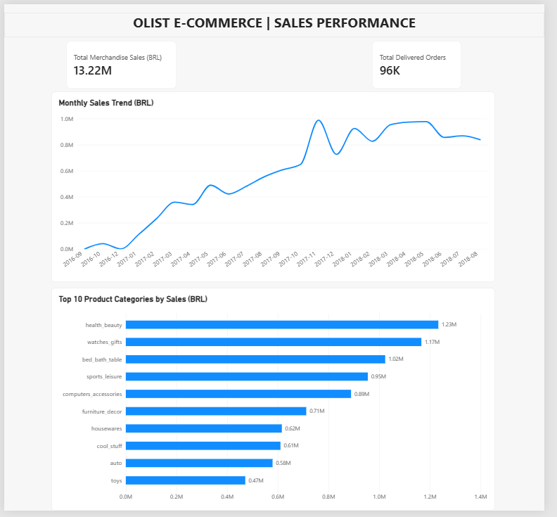

# Olist E-Commerce Business Intelligence Project

An end-to-end Data Analytics and Business Intelligence portfolio project analyzing the Brazilian e-commerce dataset from Olist. This project explores business performance, sales trends, product category contributions, delivery efficiency, customer satisfaction, and payment behavior using Python, MySQL, and Power BI.

The project demonstrates a complete analytical workflow, from raw data preparation and data quality validation to exploratory data analysis, SQL-based business analysis, and interactive dashboard development.

---

## 1. Project Overview

This project analyzes the business performance of Olist, a Brazilian e-commerce platform, using data analytics and Business Intelligence techniques.

The main objective is to transform raw transactional data into meaningful business insights that support data-driven decision-making.

The analysis focuses on five key business areas:

- Sales performance and monthly revenue trends.
- Product category contributions to total merchandise sales.
- Delivery performance and operational efficiency.
- Customer satisfaction based on delivery experience.
- Payment methods and credit card installment behavior.

The final results are presented through an interactive Power BI dashboard consisting of three analytical pages.

## 2. Project Objectives

The objectives of this project are:

1. Analyze overall merchandise sales and delivered order performance.
2. Identify monthly sales trends and high-performing product categories.
3. Evaluate delivery performance and identify late delivery patterns.
4. Analyze the relationship between delivery timeliness and customer satisfaction.
5. Understand payment methods, transaction values, and credit card installment patterns.
6. Develop an interactive Business Intelligence dashboard.
7. Translate analytical findings into meaningful business insights.

## 3. Tools & Technologies

| Tool | Purpose |
|---|---|
| Python | Data cleaning, validation, exploratory data analysis, and preprocessing |
| Pandas & NumPy | Data manipulation and numerical analysis |
| Matplotlib | Exploratory data visualization |
| Jupyter Notebook | Organizing and documenting Python workflows |
| MySQL Workbench | Database creation, data quality validation, SQL transformation, and business analysis |
| Power BI Desktop | Data modeling, DAX measures, and interactive dashboard development |
| Git & GitHub | Version control and project documentation |

## 4. Dataset

This project uses the **Brazilian E-Commerce Public Dataset by Olist**, available on Kaggle.

**Dataset Source:** [Brazilian E-Commerce Public Dataset by Olist – Kaggle](https://www.kaggle.com/datasets/olistbr/brazilian-ecommerce)

The original dataset consists of nine CSV files covering different aspects of the e-commerce business:

| No. | Dataset | Description |
|---|---|---|
| 1 | Customers | Customer information and location identifiers |
| 2 | Geolocation | Brazilian geographical coordinates |
| 3 | Order Items | Products purchased within each order |
| 4 | Order Payments | Payment methods, values, and installments |
| 5 | Order Reviews | Customer review scores and comments |
| 6 | Orders | Order status and purchase, delivery, and estimated delivery dates |
| 7 | Products | Product attributes and category information |
| 8 | Sellers | Seller information and location identifiers |
| 9 | Product Category Translation | Portuguese-to-English product category translation |

The original CSV files are stored in `Dataset/Raw/` to maintain data integrity and traceability.

Processed datasets and intermediate files are generated separately during the analytical workflow.

## 5. Data Preparation & Analysis Workflow

The project follows a structured analytical workflow consisting of Python, MySQL, and Power BI.

### 5.1 Python – Data Cleaning & Exploratory Data Analysis

Python was used to inspect, clean, validate, and explore the Olist datasets.

The Python workflow is organized into two main notebooks.

**Notebook 01 – Data Cleaning**

The data cleaning process includes:

- Inspecting dataset structures and dimensions.
- Identifying and investigating missing values.
- Checking duplicate records.
- Converting date and numeric data types.
- Investigating data inconsistencies and anomalies.
- Preparing cleaned datasets.
- Generating supporting data quality reports.

**Notebook 02 – Exploratory Data Analysis (EDA)**

The EDA process focuses on:

- Sales performance and product category contributions.
- Delivery performance and late delivery analysis.
- Customer review score comparisons.
- Payment method distribution and transaction characteristics.
- Credit card installment behavior.

The payment analysis also evaluates payment record proportions and transaction value contributions across different payment methods.

**Supporting Python Scripts**

Additional Python scripts were developed to inspect and prepare the order reviews dataset:

- `check_reviews_csv.py`
- `inspect_reviews_row.py`
- `prepare_reviews_tsv.py`

These scripts support review data inspection, preprocessing, and preparation for subsequent analysis.

### 5.2 MySQL – Data Quality Validation & Business Analysis

MySQL Workbench was used to prepare and analyze the Olist database.

A total of 25 sequential SQL scripts were developed to support the database workflow.

The SQL process includes:

- Creating the database and raw staging tables.
- Investigating missing values and duplicate records.
- Validating review identifiers and geolocation records.
- Checking numeric formats and value ranges.
- Investigating date formats and chronological inconsistencies.
- Reviewing data anomalies before determining analytical treatment.
- Creating cleaned and analytical tables.
- Developing business analysis views.
- Validating delivery and customer review analysis results.

**Final Business Analysis Views**

Six analytical views were developed to support the Power BI dashboard:

| No. | Analytical View | Purpose |
|---|---|---|
| 1 | `monthly_sales` | Analyze monthly merchandise sales and sales trends |
| 2 | `category_sales` | Evaluate product category sales contributions |
| 3 | `delivery_review_order_level` | Analyze delivery performance and customer reviews at order level |
| 4 | `delivery_rating_summary` | Summarize customer ratings by delivery performance |
| 5 | `payment_methods` | Analyze payment method distribution and transaction values |
| 6 | `credit_card_installments` | Analyze credit card installment distribution |

The delivery and review analytical view contains 96,282 eligible delivered orders, consistent with the final Python EDA results.

### 5.3 Power BI – Data Modeling & Visualization

Power BI Desktop was used to transform the prepared analytical data into an interactive Business Intelligence dashboard.

The dashboard consists of three main analytical pages.

---

## 6. Power BI Dashboard Overview

### 6.1 Sales Performance

This page provides an overview of Olist's sales performance and product category contributions.

**Key Performance Indicators:**

- Total Merchandise Sales (GMV): BRL 13.22 Million
- Total Delivered Orders: 96,478

**Visualizations:**

- Monthly Sales Trend (BRL)
- Top 10 Product Categories by Sales (BRL)

**Business Focus:**

Identify sales trends over time and determine which product categories contribute most significantly to overall merchandise sales.



### 6.2 Delivery & Customer Satisfaction

This page evaluates delivery performance and compares customer satisfaction across delivery groups.

**Key Performance Indicators:**

- Late Delivery Rate: 6.78%
- Eligible Delivered Orders: 96,282

**Visualizations:**

- Delivery Performance by Delivery Group
- Average Customer Review Score by Delivery Group

**Business Focus:**

Evaluate delivery efficiency by comparing on-time or early deliveries with late deliveries. The analysis also examines differences in average customer review scores between delivery groups.

**Metric Definitions:**

The overall delivered-order count is 96,478, while delivery performance analysis uses 96,282 eligible delivered orders.

The eligible population excludes 196 delivered orders that did not meet the defined analytical criteria.

The late delivery rate is calculated using eligible delivered orders as its denominator.


### 6.3 Payment & Transaction Analysis

This page provides insights into customer payment methods and credit card installment behavior.

**Visualizations:**

- Payment Methods Distribution
- Credit Card Installment Distribution

**Business Focus:**

Understand the distribution of payment methods used by customers and identify the most common credit card installment patterns.


---

## 7. Key Business Insights

Based on the Python EDA and SQL analysis, several findings can be highlighted.

### 7.1 Sales Performance

Total merchandise sales reached BRL 13,221,498.11, with 96,478 delivered orders.

The Average Order Value (AOV) was BRL 137.04.

These results provide an overview of Olist's overall merchandise sales performance.

### 7.2 Product Category Performance

Health and beauty, watches and gifts, and bed, bath and table were among the leading product categories by merchandise sales.

This indicates that several product categories contributed significantly to overall sales performance.

### 7.3 Delivery Performance

Out of 96,282 eligible delivered orders:

- 89,750 orders were delivered on time or early.
- 6,532 orders were delivered late.
- The late delivery rate was 6.78%.

The average delivery duration was 12.51 days.

### 7.4 Customer Satisfaction

On-time or early deliveries recorded an average review score of 4.29, while late deliveries recorded an average score of 2.27.

This indicates an association between delivery timeliness and customer satisfaction.

However, the relationship represents an observed association and does not independently establish causation.

### 7.5 Payment Behavior

Credit cards represented the largest share of payment activity.

In the Python EDA, credit cards accounted for 74.03% of payment records and 78.46% of recorded payment value.

The total recorded payment value in this analysis was BRL 15,422,461.77.

Payment analysis in SQL uses a broader dataset scope, so its payment record totals and percentages should be interpreted separately.

---

## 8. Data Quality & Analytical Considerations

Data quality validation was conducted throughout the preparation and analysis process.

Important considerations include:

- Missing values were investigated before determining their analytical treatment.
- Duplicate records were examined based on relevant identifiers.
- Date and numeric inconsistencies were validated.
- Delivered orders with missing or inconsistent delivery information were evaluated separately.
- Different analytical outputs may use different filtering criteria and data populations.
- Payment records and unique orders represent different measurement units.
- Payment records with zero credit card installments were retained as data quality anomalies for further review.

The delivery analysis uses 96,282 eligible orders rather than all 96,478 delivered orders.

The relationship between delivery timeliness and customer review scores represents an observed association and does not independently establish causation.

These considerations are important when interpreting analytical results and comparing outputs across Python, SQL, and Power BI.

## 9. Repository Structure

The repository is organized to maintain a clear separation between raw datasets, analytical workflows, SQL scripts, documentation, and Power BI files.

```text
Mini-Project-Olist/
│
├── Dataset/
│   └── Raw/
│       ├── olist_customers_dataset.csv
│       ├── olist_geolocation_dataset.csv
│       ├── olist_order_items_dataset.csv
│       ├── olist_order_payments_dataset.csv
│       ├── olist_order_reviews_dataset.csv
│       ├── olist_orders_dataset.csv
│       ├── olist_products_dataset.csv
│       ├── olist_sellers_dataset.csv
│       └── product_category_name_translation.csv
│
├── Documentation/
│   ├── 01_project_overview.md
│   ├── 02_data_dictionary.md
│   ├── 03_data_cleaning_process.md
│   ├── 04_sql_analysis.md
│   ├── 05_eda_findings.md
│   └── 06_power_bi_dashboard.md
│
├── Python/
│   ├── check_reviews_csv.py
│   ├── inspect_reviews_row.py
│   └── prepare_reviews_tsv.py
│
├── SQL/
│   └── 25 sequential SQL scripts
│
├── Screenshots/
│   ├── 01-sales-performance.png
│   ├── 02-delivery-customer-satisfaction.png
│   └── 03-payment-transaction-analysis.png
│
├── notebook/
│   ├── 01_pembersihan.ipynb
│   └── 02_eksplorasi.ipynb
│
├── Olist_Ecommerce_Dashboard.Report/
│
├── Olist_Ecommerce_Dashboard.SemanticModel/
│
├── Olist_Ecommerce_Dashboard.pbip
├── Olist_Ecommerce_Dashboard.pbix
├── .gitignore
├── .gitattributes
└── README.md
```

**Note:** Processed datasets, cleaned Python outputs, and intermediate data quality reports are generated locally and excluded from the GitHub repository.

## 10. How to Use This Project

To explore the project and reproduce the analytical workflow:

1. Clone or download this repository.
2. Locate the original Olist CSV files in the `Dataset/Raw/` directory. If any files are missing, download the original dataset from Kaggle.
3. Configure the MySQL database and import the required raw datasets.
4. Execute the relevant SQL scripts in their numbered sequence.
5. Run the Python notebooks in order, starting with `01_pembersihan.ipynb`, followed by `02_eksplorasi.ipynb`.
6. Open `Olist_Ecommerce_Dashboard.pbix` using Power BI Desktop, or open the PBIP project format.
7. Configure the data source paths and database connections according to your local environment.
8. Refresh the data in Power BI if required.
9. Navigate through the three dashboard pages to explore the business analysis and findings.

**Note:** Data source paths and database connections may need to be adjusted depending on the local directory and database configuration.

## 11. Project Scope

This project was developed as an academic and professional portfolio project to demonstrate practical knowledge of Data Analytics and Business Intelligence.

It showcases the process of transforming raw e-commerce data into structured analytical information through Python data preparation, SQL querying, data quality validation, exploratory data analysis, and interactive dashboard development.

The project emphasizes both technical implementation and business interpretation to demonstrate how data analytics can support informed business decision-making.

## 12. Author

**Angellica Ivana**

Information Systems Student

**Areas of Interest:**
- Data Analytics
- Business Intelligence
- Business Analysis
- Data Visualization

**GitHub:** [@angellica24](https://github.com/angellica24)

---

*This project is part of my learning journey in Business Intelligence and Data Analytics.*